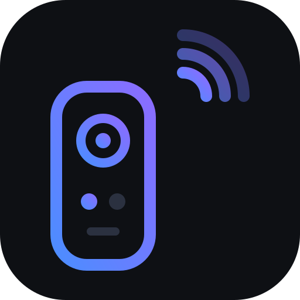

<div align="center">
  
  <h1>StbLab</h1>
  <p>
    Control an Android TV set-top box from your laptop — a from-scratch C# implementation of the
    Android TV Remote v2 protocol, an ASP.NET Core API on top of it, and a Next.js remote in the browser.
  </p>
</div>

---

A physical remote is a small infrared or Bluetooth keyboard. Everything it does is a key event, and
everything a set-top box shows you — power state, foreground app, volume — is state the box already
publishes over its own network protocol. This project speaks that protocol directly, so the remote can
be a web page.

No rooted device, no ADB, no manufacturer SDK. It pairs the same way the official Android TV remote app
does, and after that one-time step the box treats it as a normal remote.

## Why this exists

The protocol is documented in pieces and the pieces disagree. Several write-ups state that messages are
framed with a 4-byte length prefix; they are not. The reference `.proto` shipped by AOSP in
`external/google-tv-pairing-protocol` describes an envelope with a `type` and a `payload` field, which
does not match what shipping devices actually send. Neither of those is wrong so much as incomplete, and
following either one produces a client that connects successfully and then hangs.

So this is a working implementation, and the notes below are the parts that took the longest to get
right. If you are writing your own client, read [Protocol notes](#protocol-notes) first.

## What it does

- **State** — power, foreground app package, volume level and mute, device manufacturer/model/firmware.
- **Keys** — all 305 key codes the protocol defines, including long-press, with fuzzy name matching.
- **Text** — injects characters into whatever field has focus on the device.
- **Launch** — opens an app by package name, or a deep link.

Plus a browser remote with a d-pad, hold-to-repeat volume and channel rockers, media transport, app
shortcuts, and keyboard bindings, so `↑ ↓ ← → Enter` work the way you expect.

## Protocol notes

These are the findings that mattered. Everything here is verified against a real device, not inferred.

**Two ports, both mutually authenticated TLS.**

| Port | Purpose |
| --- | --- |
| 6466 | Command channel — key events, text, app launch, state |
| 6467 | Pairing channel — used once, to mint a client certificate |

Both directions present certificates. The device has one, the client generates its own before pairing,
and the pairing exchange is what gets that client certificate trusted.

**Framing is a varint length prefix, not a fixed-width one.**

```
[ varint: message length ][ protobuf: OuterMessage ]
```

A 4-byte big-endian prefix will not work. A frame can also be split across TCP reads, and a varint can
straddle two reads — `Framing.cs` buffers until a whole frame is available and treats a prefix longer
than 10 bytes as malformed rather than trusting it.

**`OuterMessage` is flat, not an envelope.**

The AOSP reference proto sends a message type plus an opaque payload field. Real devices inline the
message payload at fixed field numbers:

```proto
message OuterMessage {
  required uint32 protocol_version = 1 [default = 1];
  required Status status = 2;

  optional PairingRequest     pairing_request     = 10;
  optional PairingRequestAck  pairing_request_ack = 11;
  optional Options            options             = 20;
  optional Configuration      configuration       = 30;
  optional ConfigurationAck   configuration_ack   = 31;
  optional Secret             secret              = 40;
  optional SecretAck          secret_ack          = 41;
}
```

`proto/polo.proto` in this repository is that layout, recovered from the descriptors of the shipping
Python bindings rather than transcribed from documentation.

**Pairing is a six-step handshake, gated by a human reading a code off the TV.**

```
client                                device
  │  pairing_request                  │
  │ ─────────────────────────────────►│
  │  pairing_request_ack              │
  │ ◄─────────────────────────────────│
  │  options                          │
  │ ─────────────────────────────────►│
  │  configuration                    │
  │ ─────────────────────────────────►│
  │  configuration_ack                │
  │ ◄─────────────────────────────────│
  │                                   │  ← TV displays a 6-character code
  │  secret (SHA256 over the code)    │
  │ ─────────────────────────────────►│
  │  secret_ack                       │
  │ ◄─────────────────────────────────│
```

The secret binds the pairing code to both public keys, so a code alone is not enough to pair:

```
secret = SHA256( client_modulus ‖ client_exponent
               ‖ server_modulus ‖ server_exponent
               ‖ code[2:] )
```

Each number is big-endian with leading zero bytes stripped. The first two characters of the code are a
checksum — `secret[0] == int(code[0:2], 16)` — which is what turns a mistyped code into an immediate
local failure instead of a silent one. Six hexadecimal characters is only 16 bits of entropy, which is
why the human step exists: the code expires quickly, and the exchange is what stops the handshake from
being brute-forced from across the network.

**The device accepts exactly one active remote session.**

A second connection completes its TLS handshake and is then simply never sent any state. There is no
error and no rejection — the socket sits there healthy and silent, which reads as a hang rather than a
failure. `StbConnection` holds a single long-lived session and redials it, which is why the API serves
every request through one connection instead of dialing per request.

**Features are a negotiated bitmask.** The device replies to `remote_configure` with the subset it
supports, and the client intersects its request with that.

| Flag | Value | |
| --- | --- | --- |
| `PING` | 1 | keepalive |
| `KEY` | 2 | key events |
| `IME` | 4 | text injection |
| `VOICE` | 8 | voice search |
| `POWER` | 32 | power state |
| `VOLUME` | 64 | volume state |
| `APP_LINK` | 512 | app launch |

This project requests 615 (`PING | KEY | IME | POWER | VOLUME | APP_LINK`). A device that narrows that
set is telling you which buttons will silently do nothing.

**State arrives asynchronously, and only on change.** Which means "I have connected" and "I know the
current volume" are different moments. Reconnecting and immediately reading state reliably yields a
half-populated snapshot, so the client waits for the device to go quiet for 150 ms before reporting
itself ready.

## Repository layout

```
proto/                       wire definitions
  polo.proto                 flattened OuterMessage + pairing messages
  remotemessage.proto        key events, IME, volume, app link
src/
  StbLab.Protocol/           the protocol itself — no ASP.NET, no dependencies beyond protobuf
    Framing.cs               varint length-delimited framing
    Certificates.cs          client certificate loading and public-number extraction
    CertificateFactory.cs    self-signed certificate generation for pairing
    PairingClient.cs         the pairing handshake and secret derivation
    RemoteClient.cs          the command channel: connect, send keys/text, track state
    KeyCodes.cs              key-name resolution over the generated enum
  StbLab.Cli/                a console client, useful for pairing and for scripting
  StbLab.Api/                ASP.NET Core HTTP API over the protocol
web/                         Next.js remote UI
```

The protocol project has no ASP.NET dependency, so you can reference it from a console app, a
background service, or anything else without dragging a web server along.

## Getting started

**Prerequisites.** .NET 10 SDK, and Node.js 20+ for the web UI. You also need a device on the same
network, and the ability to see its screen — pairing needs a code that it displays.

**1. Pair.** This generates a client certificate, runs the handshake, and prompts for the code shown on
the TV:

```bash
dotnet run --project src/StbLab.Cli -- pair
```

Credentials are written to `~/stb-lab/` by default. Override with `--dir <path>` or the `STB_LAB_DIR`
environment variable. The CLI defaults to `192.168.1.128` — pass `--host <ip>` to change it.

```bash
dotnet run --project src/StbLab.Cli -- --host 192.168.1.50 pair
```

**2. Point the API at the device.** Edit `src/StbLab.Api/appsettings.json`:

```jsonc
{
  "Stb": {
    "Host": "192.168.1.128",              // <- your device
    "CertificatePath": "/home/you/stb-lab/client_cert.pem",
    "PrivateKeyPath": "/home/you/stb-lab/client_key.pem"
  }
}
```

**3. Run it.**

```bash
dotnet run --project src/StbLab.Api                              # http://127.0.0.1:5080

cd web && npm install && npm run dev                             # http://localhost:3000
```

The web app proxies `/api/*` to the API, so the browser only ever talks to one origin and there is no
CORS to configure.

## CLI

```
stb [--host <ip>] [--dir <path>] <command> [args]

  state                              connection, power, app, volume, identity
  key <NAME> [SHORT|START_LONG|END_LONG]
  text <message>                     type into the focused field
  launch <package|link>              open an app
  keys                               list every key name
  pair [code]                        pair, or complete pairing with a known code
```

```bash
dotnet run --project src/StbLab.Cli -- state
dotnet run --project src/StbLab.Cli -- key DPAD_DOWN
dotnet run --project src/StbLab.Cli -- key DPAD_DOWN START_LONG
```

## HTTP API

URL-segment versioned, so every route carries `/api/v1`. In Development an OpenAPI document is served
at `/openapi/v1.json` and a browsable UI at `/scalar/v1`.

| Method | Route | |
| --- | --- | --- |
| `GET` | `/api/v1/health` | 200 while the device link is up, 503 with a reason when it is not |
| `GET` | `/api/v1/remote/state` | power, foreground app, volume, device identity, negotiated features |
| `GET` | `/api/v1/remote/keys` | all key names |
| `POST` | `/api/v1/remote/key` | `{"key": "DPAD_UP", "direction": "SHORT"}` |
| `POST` | `/api/v1/remote/text` | `{"text": "search text"}` |
| `POST` | `/api/v1/remote/launch` | `{"app": "com.spotify.tv.android"}` |

```bash
curl http://127.0.0.1:5080/api/v1/remote/state
curl -X POST http://127.0.0.1:5080/api/v1/remote/key \
  -H 'Content-Type: application/json' \
  -d '{"key": "DPAD_DOWN"}'
```

Errors are RFC 9457 ProblemDetails. A key name that does not resolve returns 400 and names the closest
matches, ranked by edit distance, in both the message and a `suggestions` array:

```json
{
  "title": "Unknown key",
  "status": 400,
  "detail": "'volume upp' is not a known remote key. Did you mean KEYCODE_VOLUME_UP, KEYCODE_VOLUME_MUTE, KEYCODE_VOLUME_DOWN?",
  "key": "volume upp",
  "suggestions": ["KEYCODE_VOLUME_UP", "KEYCODE_VOLUME_MUTE", "KEYCODE_VOLUME_DOWN"]
}
```

## Security

**The client certificate is the credential.** After pairing, `~/stb-lab/client_cert.pem` and
`client_key.pem` are enough to control the device. Anyone holding them can press buttons. Treat them the
way you would treat an SSH private key: keep them out of version control (`.gitignore` has patterns for
this), and delete and re-pair if they leak.

**The API is unauthenticated and bound to loopback.** It assumes it is yours. It binds `127.0.0.1`
precisely so that exposing it to a network is a decision you have to make deliberately. If you change
that, anyone who can reach the port can control your TV — there is no authentication to stop them.

**Launching is fire-and-forget.** The protocol gives no acknowledgement for app launch: a package that
is not installed does nothing, and the device never says so. The API therefore reports what it sent,
not what happened. Poll `state` and watch `currentApp` if you need to know.

## Compatibility

Built and verified against:

| | |
| --- | --- |
| Device | Airtel Xstream set-top box |
| Model | `XstreamIPTV1-VT` (Vantiva UIW4078ATL) |
| SoC | Amlogic S905Y5 |
| Firmware | `7.00.956317615` |
| Android | Google TV / Cast build `3.72.446070` |

The protocol is Google's, so this should work on any Android TV or Google TV device that exposes the
remote service on 6466 and 6467 — NVIDIA Shield, Chromecast with Google TV, and most television sets
running Android TV. If you try it on something else, a note about which model and firmware is welcome.

## Legal

This is a reverse-engineered client for a protocol that is not publicly documented. It exists for
interoperability and research on hardware the author owns. The pairing handshake requires physical
access to the device and a code the device itself displays, so it cannot be used to reach a device you
do not already control.

Use it on your own equipment. Do not use it to access devices you are not authorised to access.

## License

[MIT](LICENSE).
